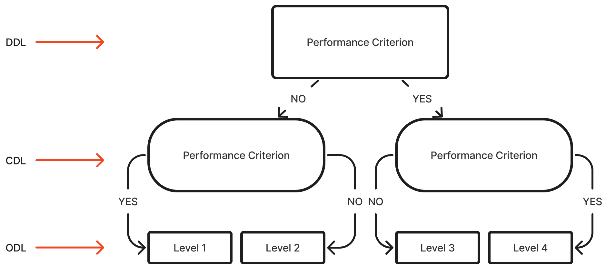

# Purpose

This manual provides users with the knowledge and skills to effectively administer, score, and interpret the Furtado-Gallagher Children Observational Movement Pattern Assessment System (FG-COMPASS), ensuring its practical application and reliability in various settings.

The FG-COMPASS an observational movement pattern assessment system designed to evaluate fundamental movement skills (FMS) in children aged 5 to 10 years. It aims to provide a more efficient and practical alternative to existing FMS assessment tools, such as the Test of Gross Motor Development-2 (TGMD-2), which is widely considered the "gold standard" in this area. The FG-COMPASS was developed by combining aspects of the composite 3-stage approach and the observational plan approach to provide a practical and efficient way for practitioners to assess FMS in various settings.

# Overview of the FG-COMPASS

The FG-COMPASS is an observational assessment tool developed to evaluate fundamental movement skill (FMS) development in children 5 to 10 years old [@furtado2018]. It was developed by combining aspects of the composite 3-stage approach [@gallahue2002] and the observational plan approach [@haywood2019] to provide a practical and efficient way for practitioners to assess FMS in various settings [@furtado2012].

The FG-COMPASS assesses ten FMS, divided into two subtests: a locomotor subtest with five skills (skipping, hopping, horizontal jumping, vertical jumping, and galloping) and an object manipulation subtest with five skills (batting, stationary dribbling, kicking, throwing, and catching). Unlike other FMS assessment tools that use multiple performance criteria for each skill, the instrument relies on only three key performance criteria selected from validated and hypothesized developmental sequences [@furtado2018]. This allows for quicker and more practical testing administration compared to more complex assessment instruments[@perez2024].

The instrument uses a process-oriented, criterion-referenced design, focusing on the quality of movement rather than quantitative measures[@perez2024]. It employs a composite decision tree approach (see Appendix A), where users make sequential decisions based on the presence or absence of specific performance criteria to classify children into levels 1 through 4. This approach aims to simplify the assessment process while providing valuable information about a child's FMS development, which can be used to evaluate the effectiveness of instructional programs and monitor/detect deficits in FMS development[@perez2024].

## Rating Scales

The FG-COMPASS was developed using a Composite Decision Tree approach (see @fig-cdt), which combines elements of the Observational Plan (OP)[@haywood2019] and the Three-Stage (TS) [@mcclenaghan1978]models for FMS assessment [@furtado2009]. The word composite refers to the practice of assessing FMS as a whole, rather than by body parts (i.e., arms, legs, torso, etc.). Even though individual body parts are considered with the composite method, the final score denotes proficiency levels for the entire body.

The OP model is a method for assessing motor skill development, particularly in FMS, by systematically observing and recording movement patterns. It emphasizes the importance of a detailed and methodical process to ensure accuracy and reliability of observations. The TS model is a framework for understanding motor skill development, emphasizing the progression from initial attempts at a skill to mature execution. It limits the classification of skills to three stages (initial, elementary, and mature) and selects only key performance criteria for the assessment tasks [@furtado2012]. An example of a performance criteria assessed in the FG-COMPASS is the "follow through" when kicking a stationary ball.

The composite decision trees (CDTs) for each assessment task in the FG-COMPASS is presented in a decision-tree format to facilitate assessment. Each CDT has three stage levels: a discriminatory-decision level (DDL), a confirmatory-decision level (CDL), and an outcome-decision level (ODL).

The DDL has a single decision node which comprises of one key performance criterion that is intended to discriminate between levels 1 and 4. The CDL is comprised of two performance criteria, each with the intention to confirm whether a performer is level 1 (if NO was selected in the DDL) or level 4 (if YES was selected in DDL). In the case of failing to confirm levels 1 and 4, they default to levels 2 and 3, respectively.

{#fig-cdt fig-align="right"}

The discriminatory-decision level holds a single decision-node that contains a performance criterion that strongly discriminates between levels 1 and 4 [@furtado2012]. The confirmatory-decision level holds two decision-nodes that confirm the child's skill level. The right-side confirmatory-decision node confirms the whether the child is at level 4, while the left confirmatory-decision node is used to confirm a level 1 skill proficiency. The outcome-decision level provides the final classification of the child's skill level, from 1 (least proficient) to 4 (most proficient).

By using this composite decision-tree approach, the FG-COMPASS aims to provide a more practical approach for assessing FMS development; thus, bypassing the need to videotape skill performance. This because it limits the number of performance criteria and classification stages compared to other FMS assessment tools [@furtado2012].

## The Importance of Fundamental Movement Skill Development

Fundamental movement skill development in children is pivotal to their comprehensive growth and overall well-being. FMS encompasses fundamental motor activities such as running, jumping, and throwing, which engage the large muscle groups of the body. These skills are crucial for physical, cognitive, and social development.

### Physical Activity and Health

Multiple studies show positive links between FMS proficiency and physical activity (PA) in children aged 3-10. For instance, @dubose2018 found children engaged in more moderate to vigorous PA scored higher in motor skills on the MABC-2. Additionally, @giuriato2022 noted that increased lean body mass predicts gross motor coordination (GMC), suggesting GMC development boosts healthy body composition. @balakrishnan2023 reported a correlation between sensory processing abilities and gross motor skills in ages 7-10, indicating improvement in motor skills may enhance sensory processing and physical activity engagement. FMS and PA relationship is reciprocal, as PA aids motor skill development. @fu2022's 12-week functional training program showed improved GMC, fitness, and sensory integration in healthy Chinese children aged 5–6, indicating that targeted interventions positively impact overall fitness. @ma2023 found a strong association between physical activity and both locomotor and object control skills in preschoolers. This suggests promoting physical activity enhances various gross motor skills, fostering a positive cycle for children's health. Overall, these studies indicate that FMS are vital in influencing PA levels and health in children aged 3-10. The reciprocal relationship emphasizes the need to promote both FMS development and PA in early childhood to foster healthy habits and overall well-being.

### Cognitive development

Numerous studies indicate substantial positive links between gross motor skills and cognitive development in children. For example, @veldman2019 found a connection in Australian toddlers, while @zuccarini2020 noted cascading effects from early motor skills on later cognitive abilities. This implies that gross motor proficiency may influence cognitive outcomes during early childhood transition. Additionally, research connects gross motor abilities with cognitive domains in children aged 3-10. @fathirezaie2022 found significant ties between executive functions, like inhibition and working memory, and gross motor skills in rural children ages 8-10. This suggests that better motor skills may enhance executive functions critical for academic success. Similarly, @geertsen2016 showed that both fine and gross motor skills correlate positively with cognitive functions and academic performance in preadolescents, emphasizing the importance of motor skill development for cognitive and educational outcomes. Moreover, studies have investigated factors affecting the motor-cognitive relationship in children aged 3-10. @viegas2021 discovered that preschoolers with low physical activity and cognitive function, especially girls, would likely have delayed gross motor skills. They concluded that these factors independently predict skill delays, indicating a direct link between motor skills and cognitive development.

The bidirectional influence of motor and cognitive skills in children aged 3-10 is significant; gross motor skills affect cognitive development, and cognitive abilities facilitate motor skill acquisition. @capio2022 established that in 5.84-year-old children, object control skills and verbal working memory are linked, illustrating the intricate relationship between physical, motor, and cognitive growth. Additionally, @bedford2015 found that early gross motor skills forecast language development in children with autism, suggesting that motor proficiency impacts other developmental areas like language acquisition. In conclusion, research strongly indicates that gross motor skill proficiency is vital for cognitive development across domains in children aged 3-10. Promoting motor skill development may yield extensive benefits for holistic development and academic readiness during early and middle childhood.

### Social development

Studies show a positive link between gross motor skills and social development in children aged 3-10. @salaj2022 found a weak correlation between motor skills and social-emotional functioning in preschoolers, underscoring the importance of gross motor skill development in enhancing children's social and emotional growth. Gross motor skills also significantly affect children's emotional understanding and social interactions. @zhang2023 discovered that object control skills predict emotional comprehension in ages 3-6, suggesting that improving these skills aids in interpreting emotions vital for social engagement. This study highlights the interconnectedness of motor, cognitive, and socio-emotional development in early childhood. Moreover, gross motor skills influence peer interactions and social competence. @redondo-tebar2021 noted that higher motor competence is associated with better health-related quality of life, especially in self-esteem and friendships among typically developing children. Enhanced motor skills foster more positive social experiences and confidence in interactions. Furthermore, @crane2023 studied motor competence in 8-year-olds, revealing a complex relationship between motor skills and social factors.

Lastly, the relationship between gross motor skills and social development varies with age and other influences. @peyre2019 found that cognitive factors predict changes in motor skills from ages 3 to 6, indicating a reciprocal relationship that can impact social growth. @barnett2016 identified age, gender, and activity levels as significant influences on gross motor competence. These findings call for a broad perspective in examining how motor skills interplay with social development.

In conclusion, the relationship between gross motor skills and social development in 3-10-year-olds is complex and changes over time. Research indicates that improving gross motor skills positively affects emotional understanding, peer interactions, and overall competence. However, this relationship varies due to multiple factors, highlighting the need for comprehensive support in child development.

## Uses of the FG-COMPASS

### Evaluating the effectiveness of instructional programs

Evaluating the effectiveness of instructional programs aimed at improving children's movement skills is a critical application of the FG-COMPASS. By using this tool to assess student outcomes before and after implementing new educational initiatives, professionals can determine whether their interventions are having a positive impact on student skill learning. This information enables teachers to refine their instruction, make adjustments as needed, and ultimately improve the overall quality of education provided to their students. Furthermore, evaluating program effectiveness also allows educators to share best practices with colleagues, promoting a culture of collaboration and continuous improvement within schools.

### Monitoring and Detecting Deficits

Monitoring the longitudinal development of students' FMS is essential in educational settings, enabling professionals to systematically track progress and make evidence-based decisions regarding instructional strategies. Regular assessment of FMS allows practitioners to identify specific areas where children may require additional support or demonstrate mastery in FMS, facilitating the customization of teaching methods to address each student's distinct developmental needs. Additionally, detecting deficits in FMS development allows professionals to provide targeted interventions, helping students catch up and overcome challenges. Early identification enables teachers to modify their instruction, making it more inclusive and accessible, thereby contributing to a more positive and supportive learning environment where every child feels valued and encouraged to succeed.

# Content Validity

To establish the content validity of the FG-COMPASS, we undertook a systematic evaluation process led by experts. This approach combined quantitative ratings with valuable qualitative feedback [@furtado2004]. We began by selecting a panel of 20 content experts, which included eight university professors and twelve experienced physical education teachers. Their extensive theoretical knowledge and practical experience made them well-equipped to provide insightful judgments. We initiated contact with these experts using a standardized protocol, starting with phone calls followed by detailed email instructions to ensure clarity.

We created an Internet-based item review form to gather evidence at both the item and test levels. Experts were asked to evaluate each proposed test item—targeting both movement concepts and fundamental movement skills—using a 4-point Likert scale that ranged from “not important at all” to “very important.” Additionally, a 5-point scale was employed at the test level to assess how well the item pool aligned with the overall purpose of the test and its representativeness in relation to content taught in physical education. This dual approach allowed us to thoroughly scrutinize both individual components and the integrated set of items.

When it came to data analysis, we employed both quantitative and qualitative methods. We calculated descriptive statistics, such as percentage distributions and median scores, to see if the items met our acceptance criteria—specifically, we set a threshold that required at least 67% of respondents to rate an item as “very” or “moderately” important. Alongside this, we carefully analyzed the qualitative comments from the experts to identify items that might have been overly specific, too easy, or not aligned with the intended domain. This careful and comprehensive analysis guided our decisions on whether to revise, collapse, or exclude certain items.

In the end, this iterative refinement process enabled us to adjust the initial pool of 31 items based on the expert input we received. The combination of expert feedback and statistical analysis ensured that the final test content accurately represented the domains of movement concepts and fundamental movement skills as defined in the National Standards for Physical Education. This thorough process not only provided strong initial support for the content-related validity of our assessment tool but also highlighted its relevance for tracking individual progress, evaluating instructional effectiveness, and pinpointing specific deficits in motor skill development.

# Expert-Rater Agreement

Expert-rater agreement is a crucial aspect of establishing the reliability and validity of any assessment tool, including the FG-COMPASS. In the context of the FG-COMPASS, expert-rater agreement refers to the level of consistency and agreement among trained raters when scoring children's performance on the assessment tasks. This is particularly important because the FG-COMPASS relies on observational assessments, which can be subjective and influenced by individual raters' interpretations.

The evolution of the FG‑COMPASS has been marked by continuous efforts to enhance its reliability and utility as an observational tool for assessing fundamental movement skills in children. Early work by @furtado2012 laid the foundation by demonstrating acceptable expert‑rater agreement on the original set of 11 rating scales, with weighted kappa values ranging from 0.51 to 0.85 (mean = 0.71). These findings established a solid basis for the instrument's reliability and led to targeted refinements in subsequent research.

In their follow‑up investigation, @furtado2018 revisited and modified the original scales, resulting in improved agreement for most measures. Their study confirmed that four of the revised scales achieved “good” to “very good” expert‑rater agreement. In contrast, the scales for side sliding and leaping—due to persistent subjectivity and inconsistency—were removed from the test. 

Building on this extensive groundwork, @perez2024 extended the instrument by investigating the inclusion of two new locomotor skills—vertical jump and gallop—to further improve the FG‑COMPASS. In their study, 60 children aged 5–10 years were filmed performing these new skills, and an expert used newly developed rating scales, based on literature‑supported performance criteria, to classify the performances. Thirty undergraduate raters underwent comprehensive training and then rated a set of video clips. The expert‑non‑expert agreement for the new vertical jump scale was exceptionally high (weighted kappa = 0.96, ICC = 0.98), while the gallop scale also demonstrated strong agreement (weighted kappa = 0.89, ICC = 0.94). Inter‑rater reliability among non‑expert raters was very good for vertical jump (mean kappa = 0.92) and reached a moderate level for gallop (mean kappa = 0.78), with intra‑rater reliability similarly robust for both skills.

Collectively, the findings of these studies indicate that the FG‑COMPASS can be relied upon for consistent classification decisions. The initial work by Furtado and Gallagher (2012, 2018) established strong expert‑rater agreement and consistency across the original skills, and the subsequent inclusion of vertical jump and gallop, as investigated by Perez and Furtado (2024), expands the scope of the locomotor subscale without compromising the instrument’s reliability. This progression underscores the FG‑COMPASS’s potential as a practical and objective tool for assessing FMS development in children, supporting its adoption in both research and educational contexts.  

# Inter-Rater Reliability

Inter‑rater reliability for the FG‑COMPASS has been examined and re‑examined through multiple studies. @woolever2016 investigated live assessments (as opposed to video‑based ones) and found that inter‑rater reliability was “good,” albeit somewhat lower than the strong values observed under controlled video conditions. Even so, their results supported the FG‑COMPASS as a practical tool for real‑world educational or research settings, where live evaluations are often needed.

A subsequent refinement by @furtado2018 involved slight revisions to the locomotor domain. Once again, multiple raters underwent systematic training and then independently scored children’s recorded performances. Here, the combined locomotor and manipulative subtests yielded an intraclass correlation coefficient (ICC) approaching 0.89, indicating improved rater consensus following the scale modifications.

More recently, @perez2024 introduced two new locomotor skills—vertical jump and gallop—to the FG‑COMPASS. A cohort of non‑expert raters was trained on these novel scales and asked to evaluate videotaped performances. The vertical jump scale demonstrated notably high inter‑rater reliability (mean weighted kappa = 0.92; ICC = 0.98), while the gallop scale, though slightly lower, still achieved robust agreement (mean weighted kappa = 0.78; ICC = 0.95).

Taken together, these studies consistently confirm that trained raters can achieve sound inter‑rater reliability when using the FG‑COMPASS to assess a broad spectrum of FMS in children, whether under controlled video conditions or in live evaluations.

# Intra-Rater Reliability

Intra‑rater reliability for the FG‑COMPASS has been documented in multiple studies using a retest or repeated‑rating format, wherein the same raters evaluated children’s performances on two different occasions and their initial and follow‑up ratings were compared. In @woolever2016, raters used the FG‑COMPASS in live physical education settings and then repeated their evaluations after a short delay. Weighted kappa statistics across locomotor and manipulative tasks ranged from about 0.70 to 0.85, indicative of “good” or “excellent” reproducibility for individual raters under real‑world conditions.

Similarly, @furtado2018 employed a video‑based approach in which raters first scored children’s recorded performances and then returned after an interval of approximately one week to re‑score the same video clips in a randomized order. Both weighted kappa and intraclass correlation coefficient (ICC) analyses confirmed “good” to “excellent” agreement between the two rounds of scoring, typically yielding kappa values above 0.80 and ICCs near or exceeding 0.90 for both locomotor and manipulative components.

More recently, @perez2024 introduced two new FG‑COMPASS scales for vertical jump and gallop and tested intra‑rater reliability in a similar fashion. After rating a set of videos, the same raters returned one week later to re‑score the same clips, with the mean weighted kappa for vertical jump reaching 0.96 (ICC = 0.98), while gallop obtained 0.85 (ICC = 0.92). Taken together, these findings indicate that once raters have received consistent FG‑COMPASS training, they can reliably replicate their own scoring decisions over time, whether the tool is used in controlled video reviews or during live assessments.

# Concurrent Validity

Concurrent validity is a crucial aspect of establishing the trustworthiness and practical utility of any assessment tool, especially in the field of motor skill development. In assessing fundamental motor skills in children, concurrent validity is particularly important because it ensures that a new assessment tool accurately reflects the child's actual motor abilities, aligning with established benchmarks. 

In their study, @woolever2016 investigated the instrument’s concurrent validity by comparing its results to those of the Test of Gross Motor Development–Second Edition (TGMD‑2) [@ulrich2000]. After children’s live skill performances were independently assessed with both tools, the researchers used the intraclass correlation coefficient (ICC) and Bland‑Altman analysis to evaluate the agreement between their locomotor, manipulative, and total scores.

They found that, for the locomotor subtest (LFMS), the FG‑COMPASS and the TGMD‑2 demonstrated an ICC of 0.68—considered “good” agreement—while the manipulative subtest (MFMS) reached an ICC of 0.89, classified as “excellent.” When combining both subtests into a single total FMS score (TFMS), the ICC remained “excellent” at 0.89. Bland‑Altman plots revealed mean biases close to zero for all three categories, indicating minimal systematic differences between the two assessments. Therefore, the FG‑COMPASS and the TGMD‑2 measure children’s gross motor proficiency in a sufficiently similar manner, thus confirming the FG‑COMPASS’s concurrent validity under live conditions