# Introduction

This section includes the Examiner Group Record Forms used to collect FG-COMPASS data. Although performances may be videotaped for subsequent assessment, the FG‑COMPASS was developed for live, in situ skill performance evaluation. Test administrators must thoroughly familiarize themselves with the testing protocols before conducting assessments. Currently, only the paper-and-pencil version of the test is available; however, a mobile version will be released shortly.

# General Instructions

1.  Review the questions within the decision tree, ensuring they are consistent with the corresponding illustrations.
2.  To promote reliable assessment, evaluate each performer across three trials. The behavior observed should be evident in at least two of the three trials to confirm consistency.
3.  Avoid inferring performance levels based on the performer's apparent age, as chronological age is not indicative of optimal performance.
4.  During demonstrations, avoid simultaneous speaking and demonstrating. Refrain from providing additional verbal information before or after the demonstration unless specifically prompted (refer to Notes for Examiners), as excessive information may confuse the performer.
5.  To improve efficiency, assess three to five children simultaneously. Confirm that each child can view your demonstration and is following the instructions. In this context, demonstrations should be performed only once.

# Equipment

-   4-inch balls are used for the overhand throw.
-   8-inch balls are used for the catch and kick.
-   Small and medium-sized basketballs
-   Nerf softballs
-   Floor tape
-   4- to 5-inch beanbags
-   Plastic cones
-   Plastic basket
-   Name tags
-   Stopwatch

# Manipulative Subscale

## Overhand Throw

### Equipment

-   Beanbags
-   Basket
-   Floor tape

### Setup

-   Tape a line 20 feet from the wall on the floor.
-   Stand about 10 feet from the examinee to get a side view of the action.
-   Place a bucket containing several bean bags three feet ahead of the line.

### Directions for performers

-   I want to see your throw;
-   Walk up to the bucket, grab one beanbag, and throw it as hard as you can against the wall without stepping over the line;
-   Then do it three more times;
-   Watch as I demonstrate.

### Notes for examiners

-   Give the performer four trials (the first trial is for practice only).
-   Do not allow performers to step over the line.

### Scale

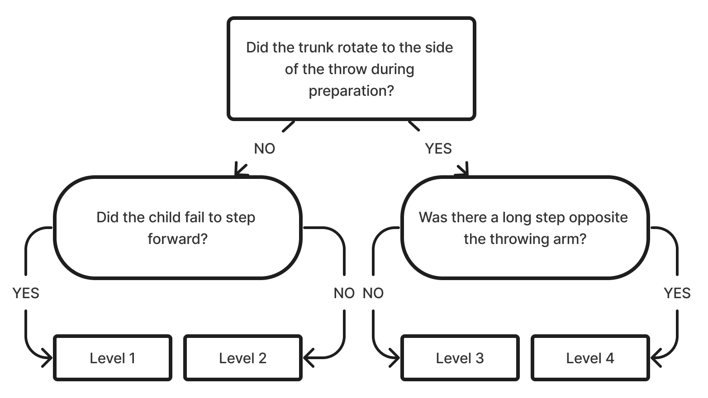{#fig-scale-ot}

### Developmental Sequences

| Image | Description |
|-------|-------------|
| 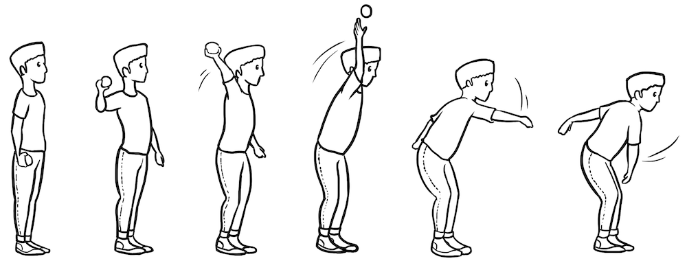{width=100%} | **Level 1** The trunk faces the target, and there is no step forward. Jumping up and down is not considered a step forward. |
| 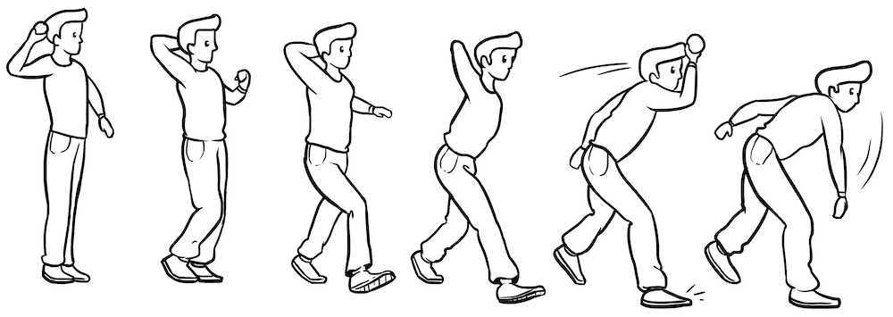{width=100%} | **Level 2** Minimal or no trunk rotation is observed during the preparatory phase. However, a forward step is taken, using either foot. |
| 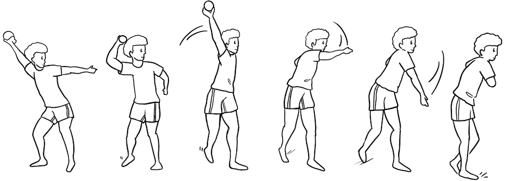{width=100%} | **Level 3** The movement involves a trunk rotation to one side and a slight step forward with the opposite leg. |
| 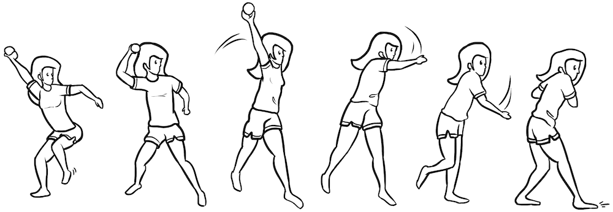{width=100%} | **Level 4** The trunk rotates to the side with a long contralateral step forward (at least half the performer's height). |

## Kick

### Equipment

-   8-inch balls
-   Floor tape
-   Basket

### Setup

-   Tape a line on the floor 20 feet from the wall (kicking line).
-   Stand about 10 feet from the examinee for a side view of the action.
-   Have a bucket with several soccer balls inside, placed 3 feet before the kicking line.

### Directions for performers

-   I want to see your kick.
-   Walk up to the bucket, grab a soccer ball, place it on the kicking line, and then kick it against the wall.
-   Then, repeat it three more times.
-   Watch as I demonstrate.

### Notes for examiners

-   Give the performer four trials (the first trial is for practice only).
-   Sometimes a child runs towards the ball, stops, and then kicks it. This is the same as not taking any steps toward the ball.
-   Swinging the body back and forward before the kick is not a complete step.

### Scale

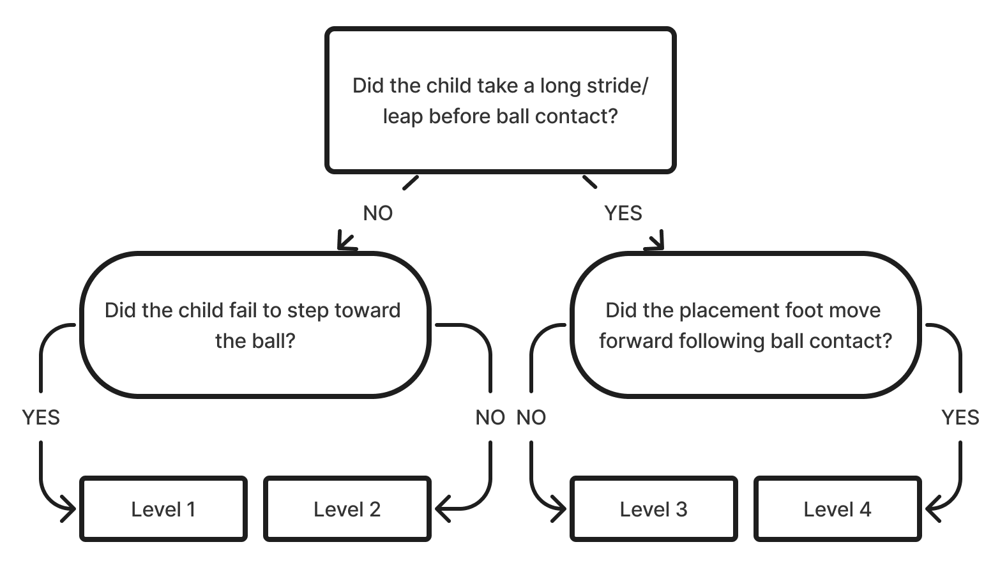{#fig-scale-kick}

### Developmental Sequences

| Image | Description |
|-------|-------------|
| 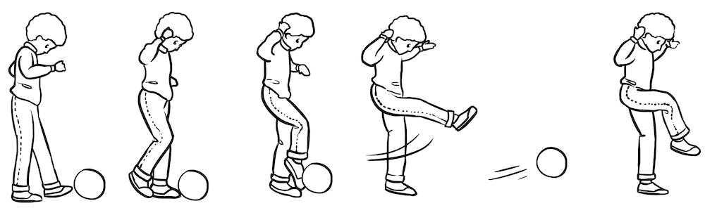{width=100%} | **Level 1** The child stands behind the ball and kicks it without stepping forward. |
| 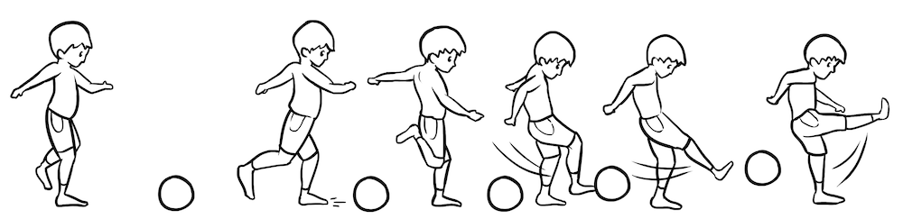{width=100%} | **Level 2** At least one step is taken before kicking the ball without a long stride or leap. It often appears as though the child runs directly through the ball. |
| 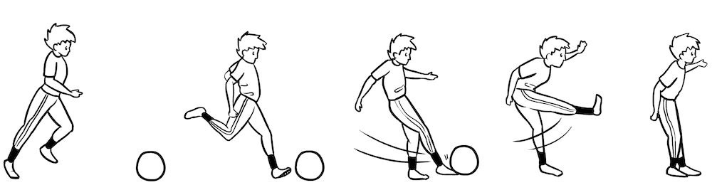{width=100%} | **Level 3** Before kicking, there are a few steps toward the ball with a lengthened stride or jump. However, there is no follow-through after the kick. |
| 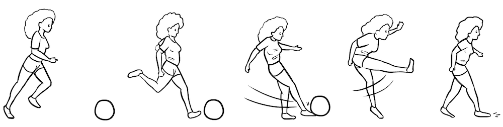{width=100%} | **Level 4** There is a long stride or leap before contacting the ball. After contact, the placement foot continues moving forward. |

## Dribble

### Equipment

-   Small and medium-sized basketballs
-   Basket
-   Floor tape
-   stopwatch

### Setup

-   Tape a 4’ x 4’ square on the floor to designate personal space.
-   Stand about 6 feet from the examinee.
-   Have a bucket with several soccer balls inside, placed 3 feet before the kicking line.

### Directions for performers

-   I want to see you dribbling a basketball with one hand.
-   Try to stay inside the square while dribbling the ball.
-   If the ball goes out of bounds, pick it up, return inside the square, and re-start.
-   I will tell you when to stop.
-   Watch as I demonstrate.

### Notes for examiners

-   Inquire about the child's preferred foot
-   Give the performer a practice trial (about 5 seconds).
-   Use a stopwatch to time the child's dribbling for 15 seconds. Stop time if the ball goes out of bounce. Resume timing when the child restarts dribbling.
-   Children who can control the ball without looking demonstrate vision-independent control. Otherwise, they are at Level 3

### Scale

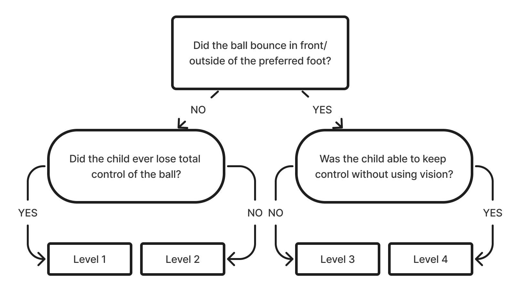{#fig-scale-dribble}

### Developmental Sequences

| Image | Description |
|:-----:|-------------|
| 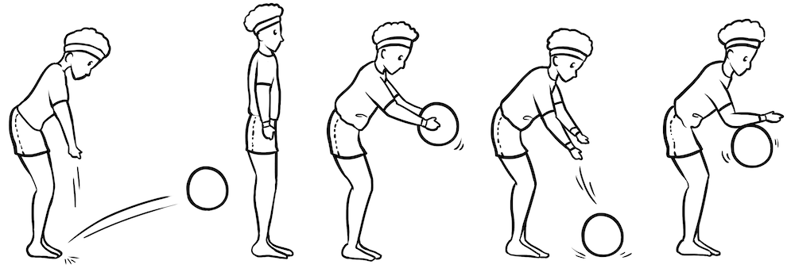{width=100%} | **Level 1** The child struggles to control the ball as it bounces erratically and loses control at least once. |
| 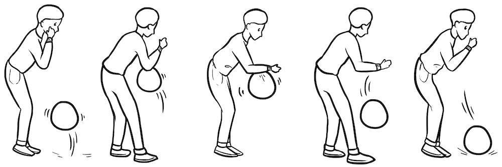{width=100%} | **Level 2** Despite a lack of control, the child bounces the ball continuously for 15 seconds. |
| 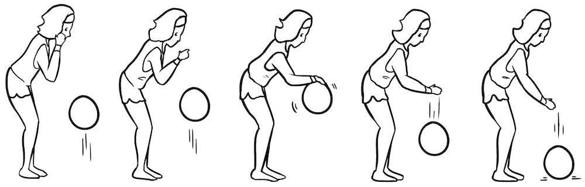{width=100%} | **Level 3** Vision is used to maintain ball control. Bounces occur in front of or to the outside of the child's preferred foot, and the child has more control over the ball. |
| 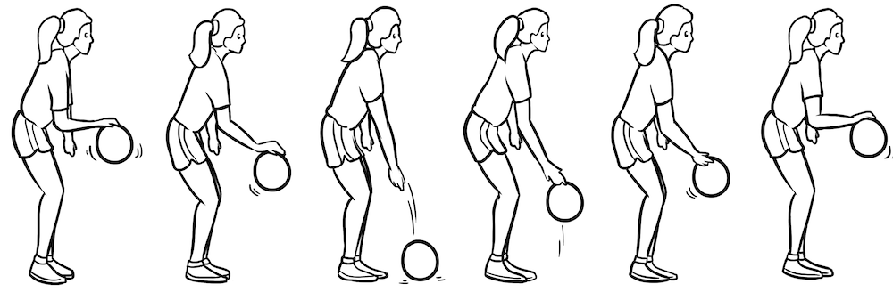{width=100%} | **Level 4** Control is clear, and the child does not rely on vision to maintain ball control. |

## Catch

### Equipment

-   4- and 8-inch balls
-   Floor tape

### Setup

-   Tape a 4'x4' on the floor to designate personal space.
-   Stand about 6 feet from the child.

### Directions for performers

-   I want to see you catch a ball with two hands.
-   Stand anywhere inside the square.
-   Watch as I demonstrate.

### Notes for examiners

-   Give the performer four trials (the first trial is for practice only).
-   Use an underhand toss and toss the ball at the child's chest level.
-   Repeat any attempt that results from a bad toss (too high/low or to the sides).
-   Only assess consistency on the three "valid" tosses.
-   If the ball is caught with hands and later brought against the chest, this indicates Level 2.
-   A behavior is considered present (answering YES) if observed in at least two trials.
-   Use either the 4-inch or 8-inch ball, depending on the child's size and strength. The 4-inch ball is recommended for smaller children.

### Scale

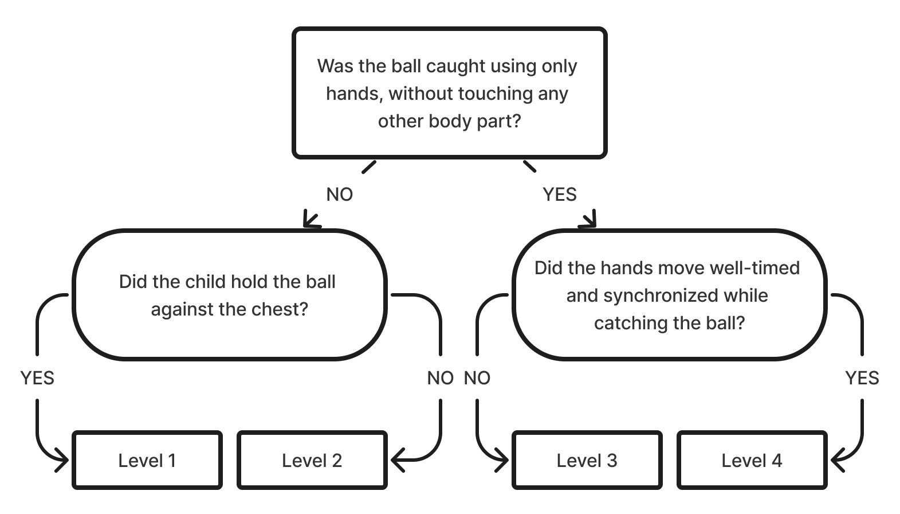{#fig-scale-catch}

### Developmental Sequences

| Image | Description |
|-------|-------------|
| 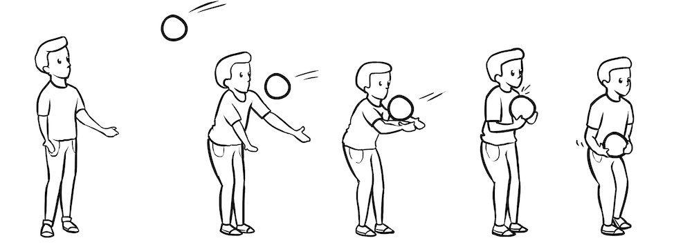{width=100%} | **Level 1** The child uses a scooping action to secure the ball against the chest. |
| 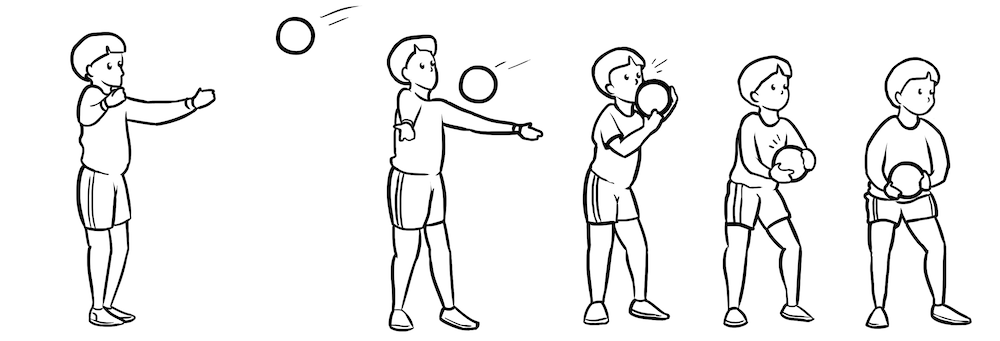{width=100%} | **Level 2** Following a successful catch, the ball is not secured against the chest but touches a body part other than the hands. |
| 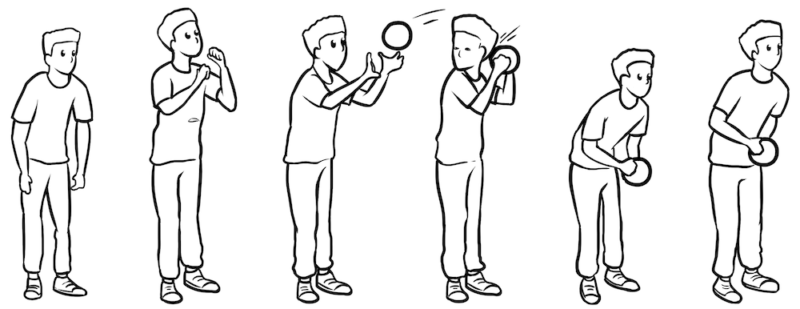{width=100%} | **Level 3** The action lacks coordination, with the ball making contact only with the hands. Players often extend their arms and/or turn their faces to the side. |
| 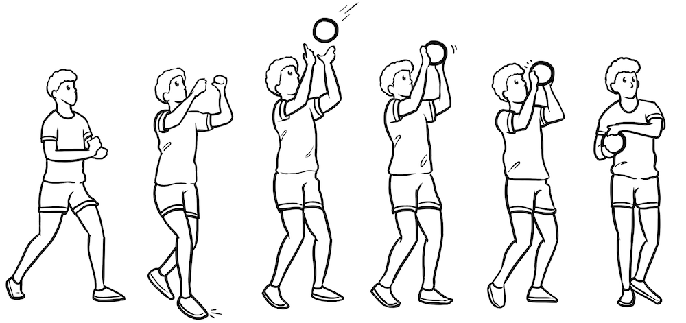{width=100%} | **Level 4** Action is well-timed with the simultaneous motion of hands. |

## Striking

### Equipment

-   Lightweight plastic bat
-   4-inch balls
-   Floor tape

### Setup

-   Tape a 4’x4’ square on the floor 20 feet from the wall.
-   Stand slightly to the side (about 12 feet), facing the child.
-   Invert the position (the child faces the opposite wall/open space) if left-handed.

### Directions for performers

-   I want to see you strike a ball tossed in your direction.
-   Try to stay inside the square, but you are free to move as the ball approaches.
-   Strike the ball against the wall/open space.
-   Watch as I demonstrate.

### Notes for examiners

-   Give the performer 4 trials (1st trial is for practice only).
-   Use an underhand toss.
-   Toss the ball just above the child's hip level.
-   Repeat any attempt that results from a bad toss (too high/low or to the sides).
-   Only assess consistency on the three “valid” tosses.
-   A behavior is considered present (answering YES) if observed in at least two trials.

### Scale

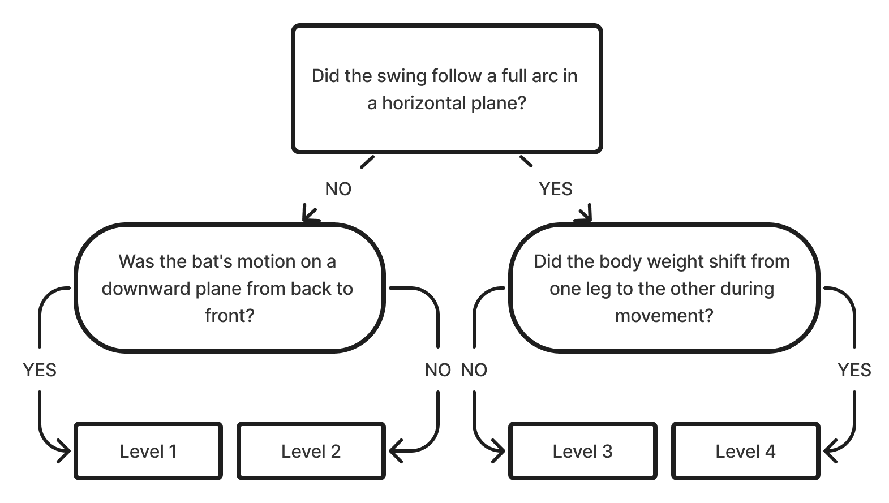{#fig-scale-strike}

### Developmental Sequences

| Image | Description |
|-------|-------------|
| 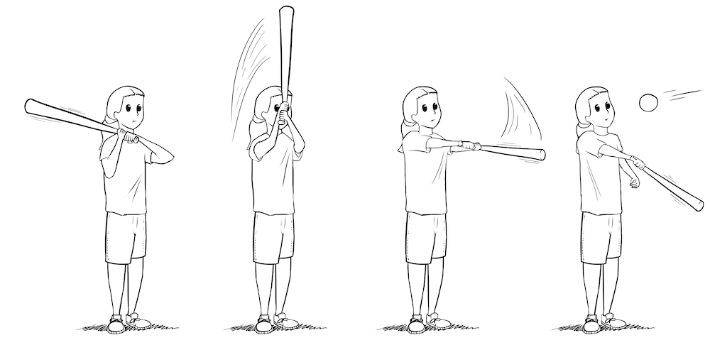{width=100%} | **Level 1** The arm action is from back to front and resembles a vertical chopping motion. |
| 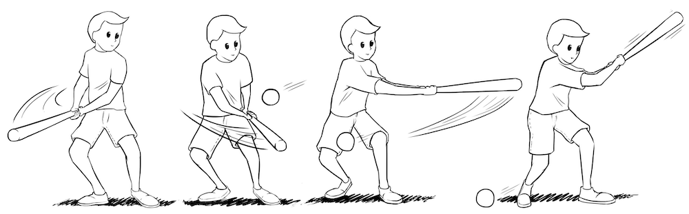{width=100%} | **Level 2** The motion occurs on the horizontal plane, but the action is limited in its amplitude. Often, the bat is held in front of the body. |
| 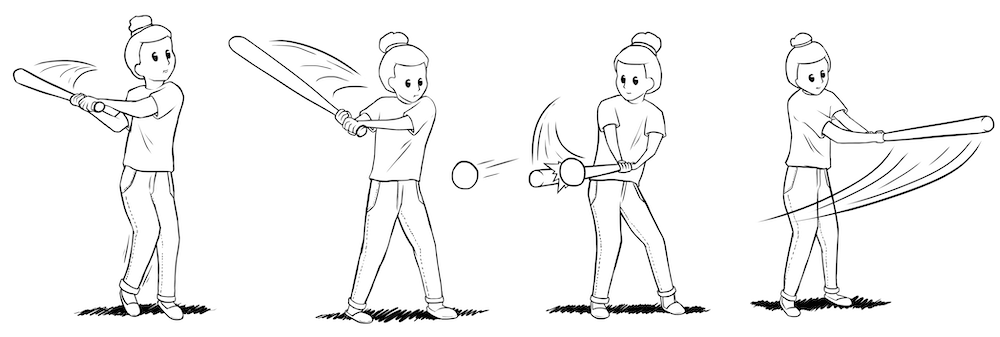{width=100%} | **Level 3** The strike does occur in a long (full arc) horizontal plan, but there is no body weight transfer. |
| 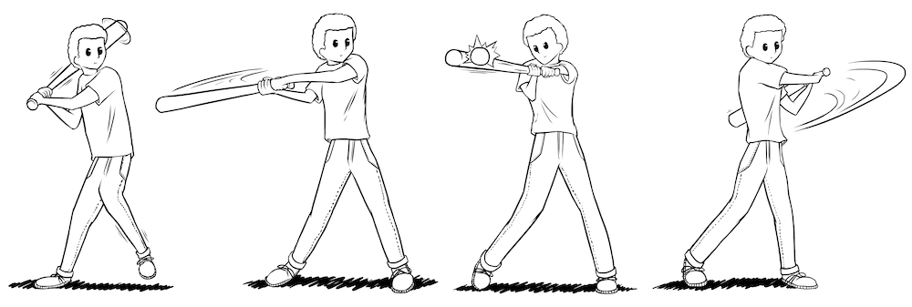{width=100%} | **Level 4** Same as Level 3, but now there is a transfer of body weight in the direction of the strike, which occurs from one to the other leg. |

# Locomotor Subscale

## Hop

### Equipment

-   Plastic cones
-   Floor tape

### Setup

-   Create a 15-long traveling lane using cones.
-   Tape starting and ending lines on the floor.
-   Stand perpendicular to the traveling lane to see the starting and ending points.
-   Place two cones (each end) 1 foot before the starting and ending lines.

### Directions for performers

-   I want to see you hopping on one leg.
-   Choose your preferred leg to hop.
-   Start from that starting line and do not stop until you pass the ending line; then come back using the same leg.
-   This is not a race; show your best form.
-   Watch as I demonstrate.

### Notes for examiners

-   Give the performer 4 trials (1st trial is for practice only).
-   A behavior is considered present (answering YES) if observed in at least two trials.

### Scale

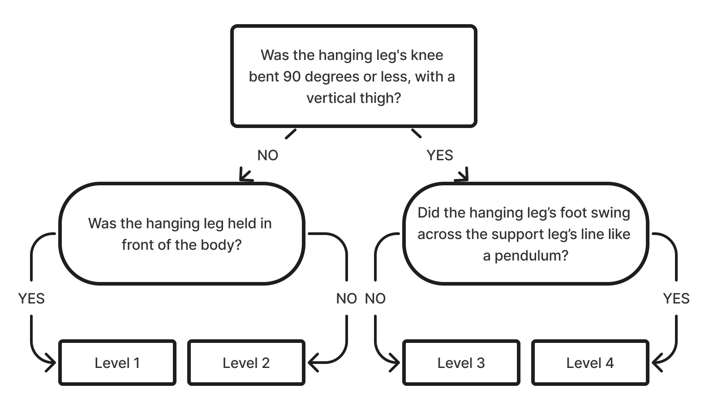{#fig-scale-hop}

### Developmental Sequences

| Image | Description |
|-------|-------------|
| 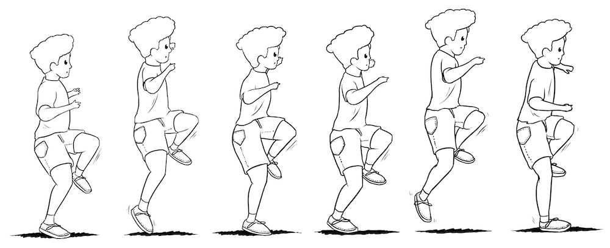{width=100%} | **Level 1** The suspended leg is held in front of the body. |
| 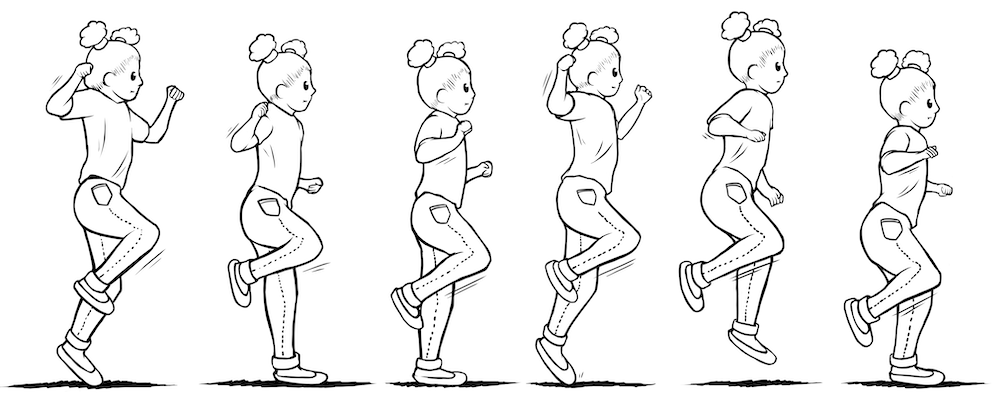{width=100%} | **Level 2** The knee is flexed with the foot of the hanging leg held near the buttocks. |
| 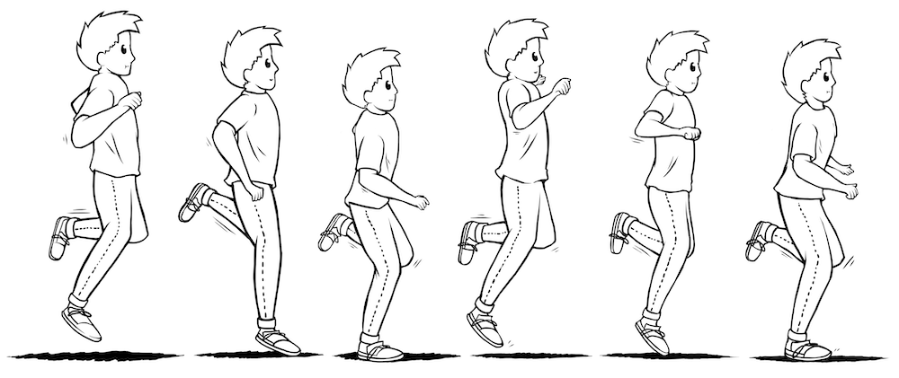{width=100%} | **Level 3** The hanging leg is held back with the thigh vertically. |
| 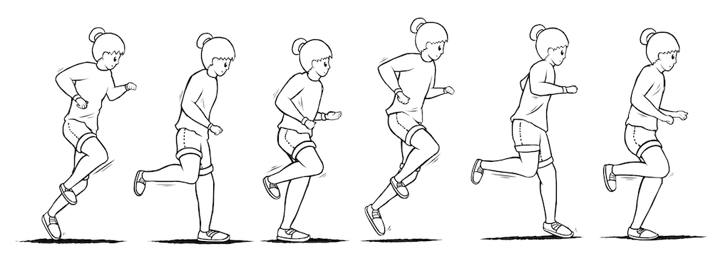{width=100%} | **Level 4** Similar to Level 3, the foot of the hanging leg crosses the line of the support leg like a pendulum. |

## Horizontal Jump

### Equipment

-   Floor tape
-   Plastic cones

### Setup

-   Tape two parallel lines on the floor two feet apart.
-   Stand perpendicular to the jumping action facing the side of the child.

### Directions for performers

-   I want to see you jumping forward over the second line and using both feet.
-   Walk up to the first line and stop completely.
-   Then, jump as far as you can over the second line.
-   Use both feet when taking off and landing.
-   Then, walk back to the starting point and do it again.
-   There is no rush; show your best jump.
-   Watch as I demonstrate.

### Notes for examiners

-   Give the performer 4 trials (1st trial is for practice only).
-   The child must stop completely behind the line before jumping.

### Scale

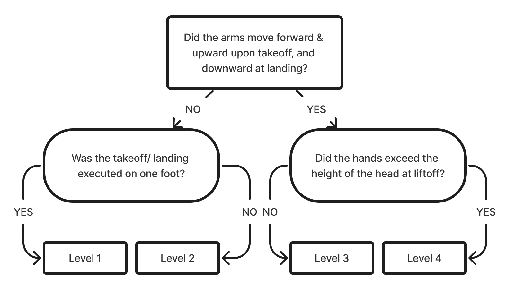{#fig-scale-hj}

### Developmental Sequences

| Image | Description |
|-------|-------------|
| 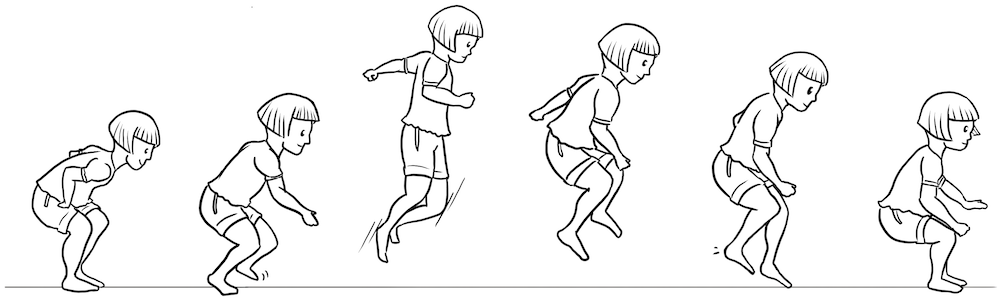{width=100%} | **Level 1** The arm action is inconsistent with no defined pattern, sometimes even motionless. The takeoff and/or landing is executed on one foot. |
| 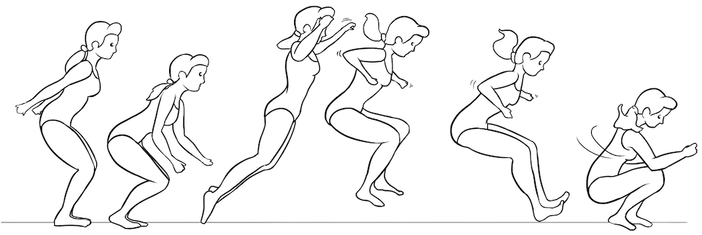{width=100%} | **Level 2** The arm action may still be inconsistent, but the takeoff/landing is executed on both feet. |
| 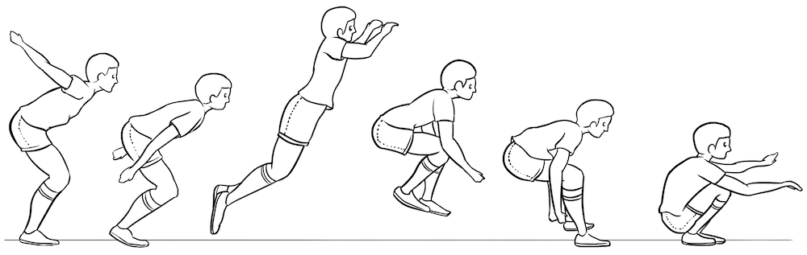{width=100%} | **Level 3** The arms move forward and upward during takeoff and then downward at landing. But the hands do not exceed the height of the head at liftoff. |
| 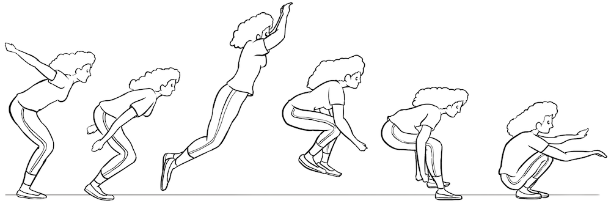{width=100%} | **Level 4** A pattern similar to Level 3, but the hands are high above the head during the liftoff. |

## Skip

### Equipment

-   Plastic cones
-   Floor tape

### Setup

-   Create a 15-long traveling lane using cones.
-   Tape starting and ending lines on the floor.
-   Stand perpendicular to the traveling lane so that you can see both the starting and ending points.
-   Place two cones (each end) 1 foot before the starting and ending lines.

### Directions for performers

-   I want to see you skipping.
-   Start from that starting line and do not stop until you pass the ending line.
-   This is not a race; show your best form.
-   Watch as I demonstrate.

### Notes for examiners

-   Give the performer 4 trials (1st trial is for practice only).
-   A behavior is considered present (answering YES) if observed in at least two trials.

### Scale

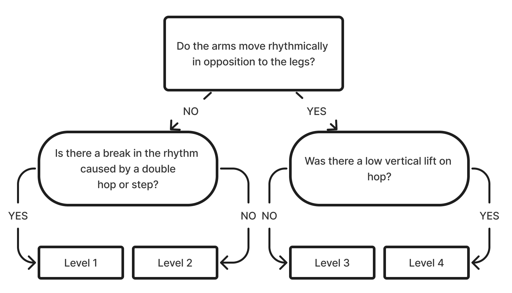{#fig-scale-skip}

### Developmental Sequences

| Image | Description |
|-------|-------------|
| 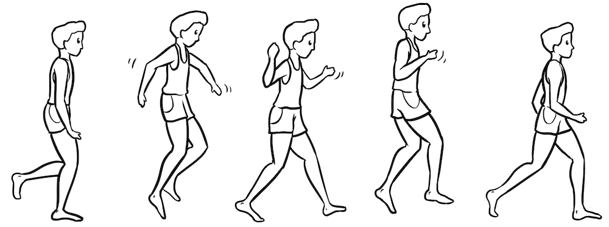{width=100%} | **Level 1** The arm action is inconsistent, with no defined pattern. A double hop or step affects the rhythm. |
| 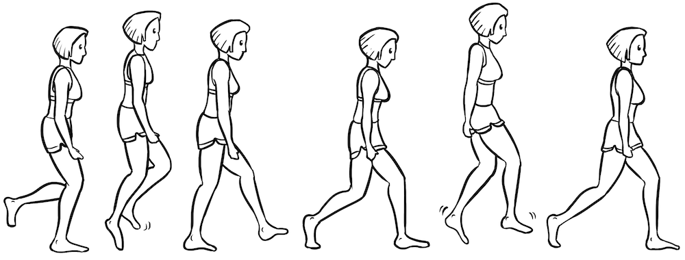{width=100%} | **Level 2** The arm motion may improve, but it is still inconsistent and often motionless. The action of the feet is well coordinated and not affected by a double hop or step. |
| 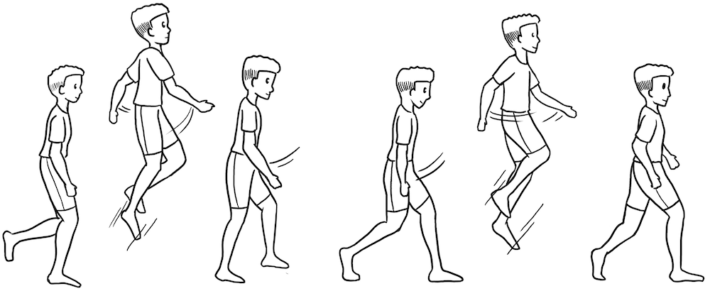{width=100%} | **Level 3** Arms move rhythmically in opposition to the legs, but the hop has an exaggerated vertical lift. |
| 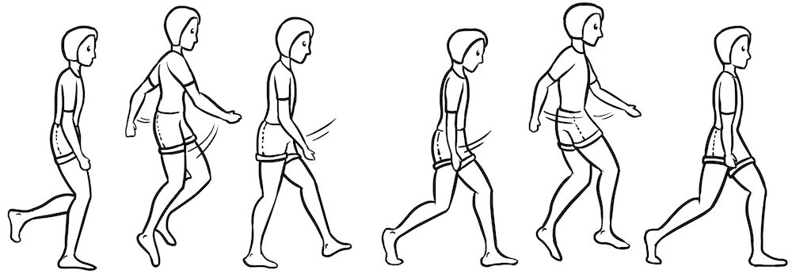{width=100%} | **Level 4** The arms move rhythmically in opposition to the legs, and the vertical lift on the hop is low. |

## Vertical Jump

### Equipment

-   Floor tape

### Setup

-   Tape four parallel lines on the wall two feet apart.
-   Stand perpendicular to the jumping action, facing the side of the performer.
-   Ask the child to stand sideways with the dominant arm facing the wall.

### Directions for performers

-   I want to see you jump high.
-   Walk up to the wall and stand sideways.
-   When I say so, jump up and touch the highest point on the wall using your dominant hand.
-   Use both feet when taking off and landing.
-   Then, get back to the starting position.
-   There is no rush; show your best jump.
-   Watch as I demonstrate.

### Notes for examiners

-Give the performer 4 trials (1st trial is for practice only). - Ask the child to show the hand he/she writes with. That will help determine the dominant hand.

### Scale

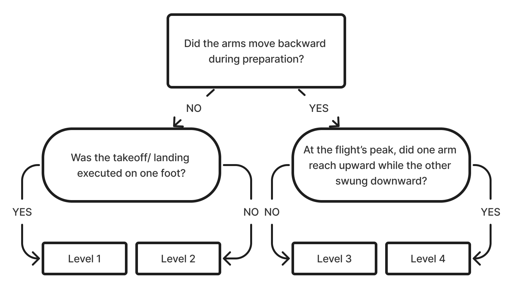{#fig-scale-vj}

### Developmental Sequences

| Image | Description |
|-------|-------------|
| 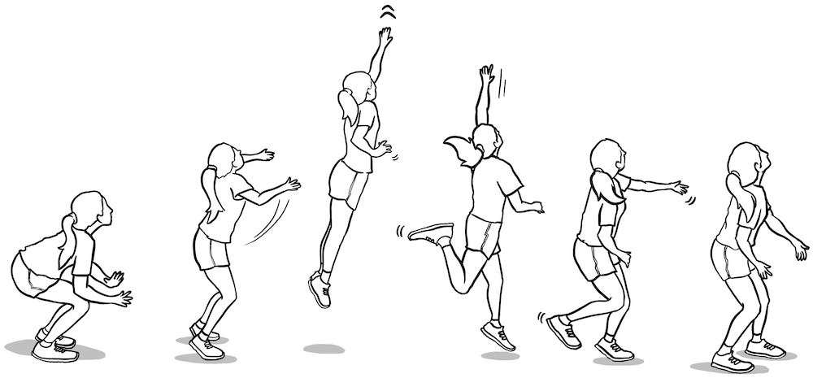{width=100%} | **Level 1** The arms don't move to the rear before taking off; the child takes off and/or lands with one foot. |
| 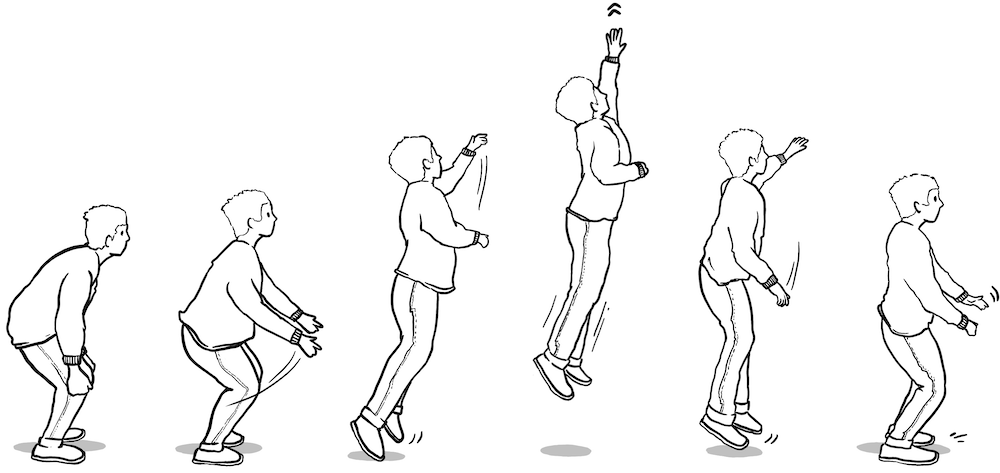{width=100%} | **Level 2** Arms don't move to the rear before takeoff; takeoff and landing occur with both feet. |
| 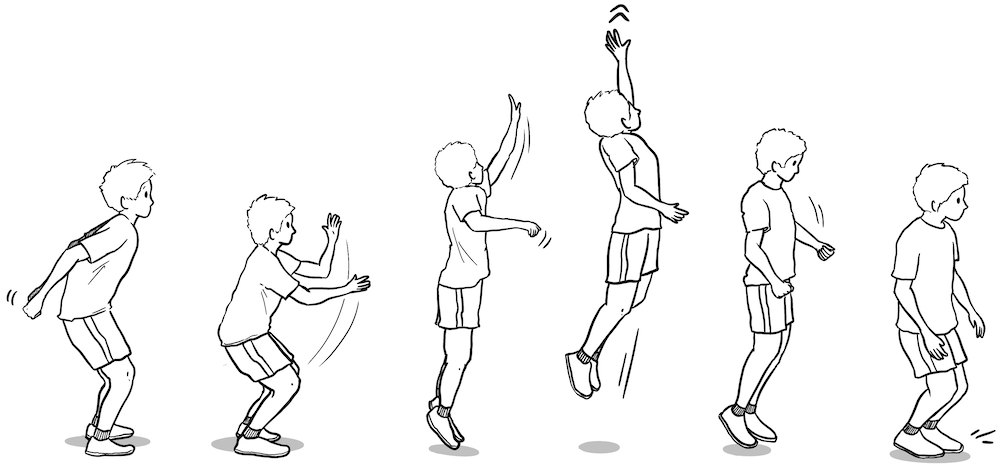{width=100%} | **Level 3** Arms move to the rear before taking off, but only the reaching arm reaches up. |
| 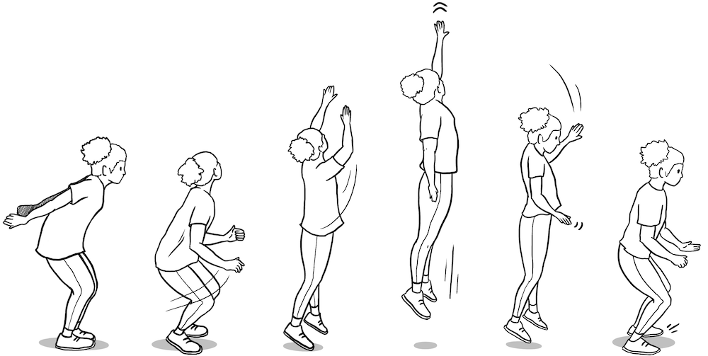{width=100%} | **Level 4** Arms move to the rear before taking off; both arms reach up, with the non-reaching arm moving down at the peak of the flight. |

## Gallop

### Equipment

-   Floor tape
-   Plastic cones

### Setup

-   Create a 15-long traveling lane using plastic cones.
-   Tape starting and ending lines on the floor.
-   Stand perpendicular to the traveling lane so that you can see both the starting and ending points.
-   Place two cones (each end) 1 foot before the starting and ending lines.

### Directions for performers

-   I want to see you galloping.
-   Start from the starting line and do not stop until you pass the ending line.
-   This is not a race; show your best form.
-   Watch as I demonstrate.

### Notes for examiners

Give the performer 4 trials (1st trial is for practice only).

### Scale

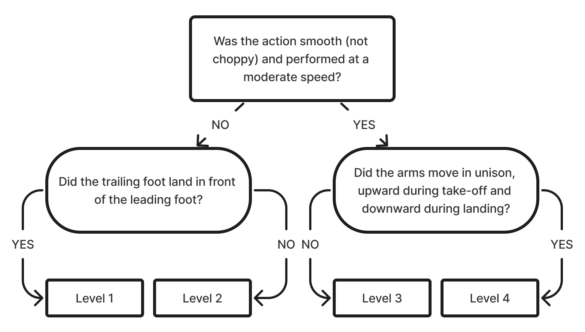{#fig-scale-gallop}

### Developmental Sequences

| Image | Description |
|-------|-------------|
| 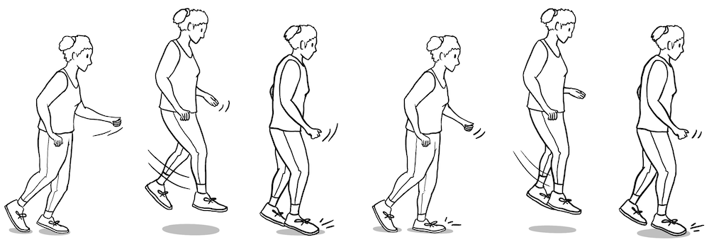{width=100%} | **Level 1** The action is not smooth and seems choppy/stiff. It is often done at a fast tempo, and the trailing foot (the foot that follows) lands in front of the leading foot. |
| 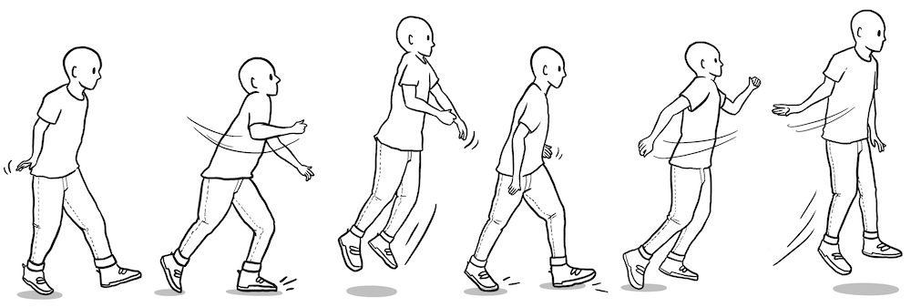{width=100%} | **Level 2** Still not a smooth action, but while the trailing foot may cross the leading foot during airborne action, it does not land in front of the leading foot. |
| 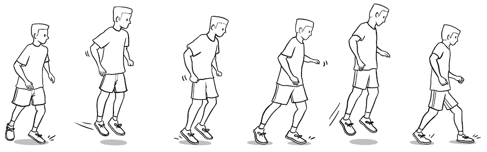{width=100%} | **Level 3** The action is smooth, rhythmical, and done at a moderate tempo, but the arm action lacks a defined pattern. |
| 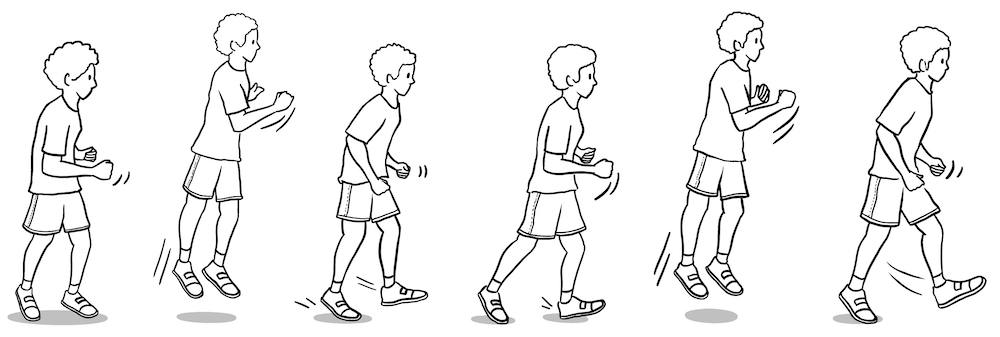{width=100%} | **Level 4** The action is smooth, rhythmical, and done at a moderate speed; the arms (elbows) are lifted to waist Level at takeoff and moved down at landing. |
