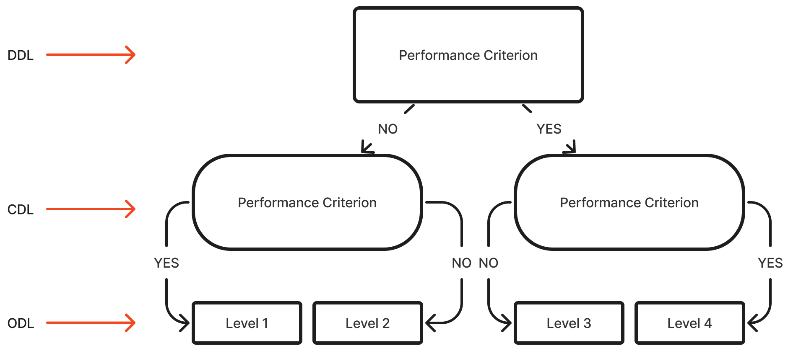

-   I Introduction
    -   Purpose of the manual
    -   Overview of the FG-COMPASS
        -   Scales
        -   Importance of assessing FMS
        -   Competency in FMS is linked to:NO NEED
            -   Decreased levels of obesity \[6\]
            -   Increased levels of physical activity and sports participation \[6\]
            -   Prevention of weight gain \[2\]
            -   Early identification of delays in FMS development allows for timely intervention and support. \[2, 7\]
        -   Uses of the FG-COMPASS

# Purpose

This manual provides users with the necessary knowledge and skills to effectively administer, score, and interpret the Furtado-Gallagher Children Observational Movement Pattern Assessment System (FG-COMPASS), ensuring its practical application and reliability in various settings.

# Overview of the FG-COMPASS

The FG-COMPASS is an observational assessment tool developed to evaluate fundamental movement skill (FMS) development in children 5 to 10 years old [@furtado2018]. It was developed by combining aspects of the composite 3-stage approach (ref) and the observational plan approach (ref) to provide a practical and efficient way for practitioners to assess FMS in various settings [@furtado2012].

The FG-COMPASS assesses ten FMS, divided into two subtests: a locomotor subtest with five skills (skipping, hopping, horizontal jumping, vertical jumping, and galloping) and an object manipulation subtest with five skills (batting, stationary dribbling, kicking, throwing, and catching). Unlike other FMS assessment tools that use multiple performance criteria for each skill, the instrument relies on only a three key performance criteria selected from validated and hypothesized developmental sequences [@furtado2018]. This allows for quicker and more practical administration compared to more complex assessment instruments [@perez2024].

The instrument uses a process-oriented, criterion-referenced design, focusing on the quality of movement rather than quantitative measures[@perez2024]. It employs a composite decision tree approach (see Appendix A), where users make sequential decisions based on the presence or absence of specific performance criteria to classify children into levels 1 through 4. This approach aims to simplify the assessment process while providing valuable information about a child's FMS development, which can be used to evaluate the effectiveness of instructional programs and monitor/detect deficits in FMS development [@perez2024].

## Rating Scales

The FG-COMPASS was developed using a Composite Decision-Tree approach (see @fig-cdt), which combines elements of the Observational Plan (OP)[@haywood2009] and the Three-Stage (TS) [@mcclenaghan1978]models for FMS assessment [@furtado2009]. The OP model is a structured method for analyzing motor development, particularly in movement skills, by systematically observing and recording movement patterns. This approach emphasizes the importance of a detailed and methodical process to ensure accuracy and reliability in observations. The TS model is a framework for understanding motor skill development, emphasizing the progression from initial attempts at a skill to mature execution. It limits the classification of skills to three stages (initial, elementary, and mature) and selects only key performance criteria for the assessment tasks @furtado2009

The composite decision trees (CDTs) for each assessment task in the FG-COMPASS is presented in a decision-tree format to facilitate assessment.

Each CDT has three stage levels: a discriminatory-decision level (DDL), a confirmatory-decision level (CDL), and an outcome-decision level (ODL).

The DDL has a single decision node which comprises of one key performance criterion that is intended to discriminate between levels 1 and 4. The CDL is comprised of two performance criteria, each with the intention to confirm whether a performer is level 1 (if NO was selected in the DDL) or level 4 (if YES was selected in DDL). In the case of failing to confirm levels 1 and 4, they default to levels 2 and 3, respectively.

{#fig-cdt fig-align="right"}

The discriminatory-decision level holds a single decision-node that contains a performance criterion that strongly discriminates between the initial and mature levels of skill development. **(Furtado, 2009, p. 29)** The confirmatory-decision level holds two decision-nodes that confirm the child's skill level. The upper confirmatory-decision node confirms the mature level, while the lower confirmatory-decision node confirms the initial level. **(Furtado, 2009, p. 29)** The outcome-decision level provides the final classification of the child's skill level. **(Furtado, 2009, p. 29)**

By using this composite decision-tree approach, the FG-COMPASS aims to provide a practical assessment tool that can be easily used by teachers in school settings, as it limits the number of performance criteria and classification stages compared to other FMS assessment tools. **(Furtado, 2009, pp. 27–28)**

## The Importance of Fundamental Movement Skill Development

Fundamental movement skill (FMS) development in children is pivotal to their comprehensive growth and overall well-being. FMS encompasses fundamental motor activities such as running, jumping, and throwing, which engage the large muscle groups of the body. These skills are crucial for physical, cognitive, and social development.

### Physical Activity and Health

Multiple studies have found significant positive associations between gross motor skills and physical activity (PA) in children aged 3-10 years. For example, @dubose2018 found that children who spend more time in moderate and moderate-to-vigorous physical activity have higher total motor skill scores on the Movement Assessment Battery for Children-2nd edition (MABC-2). In addition, @giuriato2022 found that greater lean body mass predicts gross motor coordination (GMC), suggesting that developing GMC contributes to healthier body composition. Additionally, @balakrishnan2023 reported a significant correlation between sensory processing abilities and gross motor skills in children aged 7-10, implying that improving gross motor skills may enhance sensory processing and engagement in physical activities.

Moreover, the relationship between gross motor skills and physical activity is reciprocal, as physical activity also aids motor skill development. @fu2022 demonstrated that a 12-week motor-focused functional training program significantly improved gross motor abilities, physical fitness, and sensory integration in healthy Chinese children aged 5–6. This indicates that targeted interventions can positively impact overall fitness and health. Furthermore, @ma2023 found that physical activity was strongly associated with both locomotor and object control (manipulative) skills in preschoolers. These results suggest that encouraging physical activity can enhance various gross motor skills, fostering a beneficial cycle for children's health and development.

Together, these studies suggest that gross motor skills play a crucial role in influencing physical activity levels and overall health in children aged 3-10. The relationship appears to be reciprocal, with improvements in gross motor skills leading to increased physical activity, and vice versa. This underscores the importance of promoting both gross motor skill development and physical activity in early childhood to establish healthy habits and support overall well-being.

### Cognitive development

Multiple studies have found significant positive associations between gross motor skills and cognitive development in children aged 3-10 years. For instance, @veldman2019 reported that gross motor skills are positively linked with cognitive development in Australian toddlers. Similarly, @zuccarini2020 identified cascading effects of early gross motor skills on later motor and cognitive development. These findings suggest that gross motor proficiency influences cognitive outcomes as children grow from toddlerhood to early childhood.

Secondly, research has linked gross motor abilities with specific cognitive domains in children aged 3-10 years. @fathirezaie2022 found significant relationships between executive functions—such as inhibition, working memory, and planning—and gross motor skills in rural children aged 8-10 years. This suggests that higher gross motor proficiency may support the development of executive functions important for academic success and self-regulation. Similarly, @geertsen2016 demonstrated that fine and gross motor skills positively correlate with cognitive functions and academic performance in mathematics and reading comprehension among preadolescent children. These findings highlight the importance of motor skill development for cognitive and academic outcomes during early to middle childhood.

Thirdly, studies have explored factors mediating the relationship between motor and cognitive skills in children aged 3-10 years. @viegas2021 found that preschoolers with low habitual physical activity (HPA), low cognitive function (CF), and girls were more likely to have delayed gross motor skills. They concluded that HPA and CF are independent predictors of gross motor skill delays, suggesting a direct relationship between gross motor skills and cognitive development in early childhood.

The bidirectional motor-cognitive relationship in children aged 3-10 years is noteworthy. Gross motor skills influence cognitive development, and cognitive abilities contribute to motor skill acquisition. @capio2022 found that object control skills and verbal working memory were associated in children averaging 5.84 years old, highlighting the complex interplay between physical, motor, and cognitive development. Additionally, @bedford2015 observed that early gross motor skills predict subsequent language development in children with autism spectrum disorder, suggesting that motor proficiency can impact other developmental domains such as language acquisition in both typical and atypical early childhood development.

Taking together, the research strongly suggests that gross motor skill proficiency plays an important role in supporting cognitive development across various domains in children aged 3-10 years. Promoting motor skill development may have wide-ranging benefits for children's overall development and academic readiness throughout early and middle childhood.

### Social development

Studies demonstrate a positive association between gross motor skills and social development in typically developing children aged 3-10 years. @salaj2022 reported a weak correlation between motor skills and social-emotional functioning in preschoolers, indicating a connection between motor competence and social-emotional development. This emphasizes the need to include gross motor skill development in comprehensive approaches to foster children's social and emotional growth.

Moreover, the development of gross motor skills significantly influences children's emotional comprehension and social interactions. @zhang2023 found that object control skills directly and indirectly (via inhibitory control) predict emotional understanding in children aged 3-6 years. These results indicate that enhancing gross motor skills, especially object control, can improve children's ability to interpret emotions, which is crucial for effective social engagement. The study underscores the interrelatedness of motor, cognitive, and socio-emotional development in early childhood.

Thirdly, gross motor skills significantly impact children's peer interactions and social competence. @redondo-tebar2021 reported that higher gross motor competence is linked to improved health-related quality of life, particularly in self-esteem, friendships, and school contexts among typically developing children. This suggests that enhanced motor skills contribute to more positive social experiences and greater confidence in peer interactions. Furthermore, @crane2023 examined the relationship between motor competence, physical activity, and perceived physical competence in 8-year-old children. Although they did not find a mediating effect of perceived competence, their study highlights the complex interplay between motor skills and social factors in child development.

Lastly, the relationship between gross motor skills and social development is influenced by various factors and evolves as children grow. @peyre2019 found that cognitive factors predict changes in motor skills between ages 3 and 5-6 years, indicating a bidirectional relationship between cognitive and motor development that may affect social growth. Additionally, @barnett2016 identified that age, gender, and physical activity levels significantly influence gross motor competence in children and adolescents. These findings highlight the need to consider multiple factors when examining the interplay between gross motor skills and social development in typically developing children.

In conclusion, the relationship between gross motor skills and social development in children aged 3-10 is intricate and variable. Research indicates that enhancing gross motor skills can positively influence emotional understanding, peer interactions, and overall social competence. However, this relationship is moderated by various factors and evolves as children grow, highlighting the need for multifaceted approaches in supporting child development.

## Uses of the FG-COMPASS

### Evaluating the effectiveness of instructional programs

Evaluating the effectiveness of instructional programs aimed at improving children's movement skills is another critical application of the FG-COMPASS. By using this tool to assess student outcomes before and after implementing new educational initiatives, professionals can determine whether their interventions are having a positive impact on student skill learning. This information enables teachers to refine their instruction, make adjustments as needed, and ultimately improve the overall quality of education provided to their students. Furthermore, evaluating program effectiveness also allows educators to share best practices with colleagues, promoting a culture of collaboration and continuous improvement within schools.

### Monitoring and Detecting Deficits

Monitoring the longitudinal development of students' fundamental movement skills (FMS) is essential in educational settings, enabling professionals to systematically track progress and make evidence-based decisions regarding instructional strategies. Regular assessment of FMS allows practitioners to identify specific areas where children may require additional support or demonstrate mastery in FMS, facilitating the customization of teaching methods to address each student's distinct developmental needs. Additionally, detecting deficits in FMS development allows professionals to provide targeted interventions, helping students catch up and overcome challenges. Early identification enables teachers to modify their instruction, making it more inclusive and accessible, thereby contributing to a more positive and supportive learning environment where every child feels valued and encouraged to succeed.